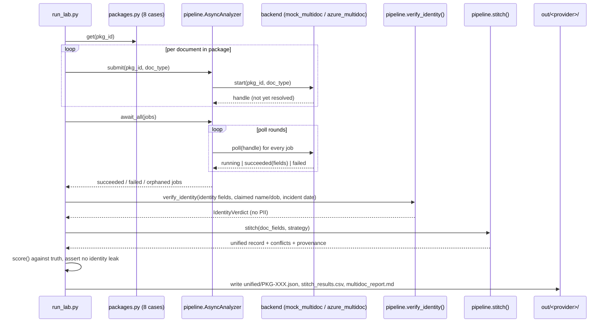

# Project Analysis — Sprint 1 · Day 15: Multi-Document Processing Lab (DecisionStream AI)

**Repository path:** `Codes/RunCompleted/Assignment8/`
**Project ID:** `FDE-D15-MULTIDOC` (provisional — no existing inventory ID found in the repository or workspace)
**Analysis date:** 2026-10-12
**Analyst role:** Repository inspection only. No code was executed, modified, or re-run to produce this report; all execution evidence below was already present on disk from prior runs by the repository owner.

---

## 0. Evidence legend (used throughout)

| Label | Meaning |
|---|---|
| `Source-observed` | Directly established by reading code/config/docs in this repo |
| `Execution-verified` | Confirmed by actual execution artifacts found on disk (`out/`, cache files) |
| `Code-derived expectation — not executed` | Inferred from code but no run evidence inspected for this specific claim |
| `Inference` | Reasoned interpretation, not directly stated in source |
| `Proposed improvement` | A recommendation, not a description of current behaviour |

---

# PART I — PROJECT AND BUSINESS UNDERSTANDING

## 1. Project identity and executive summary

| Field | Value |
|---|---|
| Project name | Sprint 1 · Day 15 Lab — Multi-Document Processing (`DecisionStream AI`, Birlasoft FORGE FDE Academy) |
| Repository path | `Codes/RunCompleted/Assignment8/` |
| Project type | Training lab / hands-on exercise with a companion teaching game, not a shippable product |
| Domain | Insurance motor-claims intake — identity verification, income/account verification, multi-document reconciliation |
| Primary users | FDE (Field Deployment Engineer) trainees on the Birlasoft FORGE Academy course; secondarily, trainers running the companion `Reconciliation_Game` |
| Main technologies | Python 3 standard library only (core lab); `python-docx` for a companion Word document; Azure AI Document Intelligence REST API (`prebuilt-layout` + Query Fields add-on); optional Streamlit for the game's board UI |
| Primary capability demonstrated | Turning **4 independently-extracted documents per case** into **1 unified, defensible record**, through an explicit precedence/stitching strategy, with identity verification that returns a verdict but never retains the underlying evidence |
| Implementation maturity | `Execution-verified`. Fully implemented, self-tested (108 offline checks reported passing), and actually run against both a mock backend and a real Azure Document Intelligence resource, including the `--overask` adversarial mode |
| Execution status | `Execution-verified`. `out/mock/` and `out/azure/` both contain populated reports, CSVs, unified JSON records and (for azure) raw cached service responses and a query-field cost report |
| Test status | `Source-observed`. `multidoc_lab/selftest.py` defines 108 checks (5 test groups); `Reconciliation_Game/reconciliation_game/selftest_game.py` defines a further 218 checks for the game. Pass/fail counts for *this specific inspection* were not re-run (`Execution-verified` only for the prior runs captured in `out/`) |
| Most important limitation | The entire "service" is two mock/real Document-Intelligence backends feeding a **business-logic layer (identity verification, stitching, precedence) that is 100% hand-written and untested against anything but this lab's own 8 synthetic cases** — see §15 |
| Most valuable learning opportunity | Seeing, with a real paid API call, that **extraction quality was never the risk** — the real Azure run reproduced the mock's results exactly (§7 of the README; confirmed in `out/azure/`), while the home-written reconciliation logic is where every defect in the lab lives |

**One-paragraph summary:** This repository is a self-contained, runnable training lab that simulates an insurance claims-intake pipeline ingesting four related documents per case (application form, identity document, payslip, bank statement) across eight synthetic case packages. It demonstrates asynchronous document processing orchestration, a strict identity-verification boundary that discards raw PII evidence, three competing "stitching" strategies for resolving disagreements between documents, and a Blob storage path-naming scheme designed around retention/residency policy. The lab runs entirely offline against a deterministic mock provider by default, and can be re-pointed at a real Azure AI Document Intelligence resource with no changes to the business logic, which is used to make a measured point: the real service's extraction was essentially perfect, and the risk the lab is teaching is entirely in the reconciliation code, not the vendor's API. A companion sub-project, `Reconciliation_Game`, turns the same case corpus into a scored tuning exercise that empirically demonstrates that no amount of parameter-tuning substitutes for switching on explicit validation checks.

## 2. Business problem and value

**Source-observed / Inference, clearly a course exercise — not a real deployment.**

- **Real-world situation modelled:** An insurance company (fictional "DecisionStream AI" / "Acme Insurance") receives motor-claim applications. Each claim arrives with up to five supporting documents (application form, driving licence/passport, one or two payslips, a bank statement) that must be reconciled into a single applicant record before a claim can proceed.
- **Workflow:** Documents are submitted for OCR/field extraction (via Azure Document Intelligence's Query Fields add-on), processed asynchronously, cross-checked against each other, and combined into one record with provenance tracking for every field.
- **Stakeholders:** Claims handlers (who must act on flagged conflicts), compliance/audit (who need provenance and a defensible identity-verification trail), finance (who are exposed if a wrong bank account number is accepted), and the applicant (whose claim is delayed if flagged, or whose claim could be paid to the wrong account if not).
- **The core problem:** Each individual document can be extracted with high confidence and still be *collectively* wrong — e.g., a bank statement belonging to a different person (PKG-008), or an account number differing by one digit (PKG-005). The lab demonstrates that this class of defect is invisible to document-level extraction quality metrics.
- **Consequences of leaving it unresolved:** A claim could be paid into the wrong account, or a claim could proceed for an applicant whose identity does not match their supporting documents — described in the lab as the thing that "can hurt a customer."
- **How the implementation addresses it:** Three alternative reconciliation strategies are implemented and empirically compared (`trust_form`, `trust_evidence`, `reconcile`), with a scoring harness (`run_lab.py`) that measures "wrong accepted" values as the primary risk metric, not accuracy in isolation.
- **Business value (potential, not measured in dollars):** A trainee who completes this lab can articulate, with a concrete worked example, why "the record looks complete" is not the same as "the record is correct," and can quantify the trade-off between refusing ambiguous data (handler cost) and silently accepting it (customer-harm risk).
- **Limitations:** This is a synthetic, 8-case corpus with hand-authored "ground truth." No customer data, no production deployment, and no quantified financial outcome exists anywhere in the repository. Any claim of cost savings, fraud prevented, or production-readiness would be fabricated — none is made in the source material, and none is made here.
- **How value could be measured (if deployed for real):** Number of fraudulent/misdirected payments prevented per period; handler time spent on flags vs. the baseline of manual review; distribution of "wrong accepted" vs. "refused" under production document-loss rates.

## 3. Technical and educational problem

**Source-observed.**

The engineering problem demonstrated is **multi-source record reconciliation under genuine asynchronous I/O and unreliable field extraction**, specifically:

1. **Why a naive implementation is insufficient:** A pipeline that simply "trusts the form" or "trusts the evidence" produces a *complete-looking* record on every run, including the wrong one — which the lab argues is more dangerous than an incomplete one, because a complete record does not visibly ask for review.
2. **Engineering concepts explored:**
   - Asynchronous submit/poll orchestration with a **provider-agnostic seam** (`start`/`poll`), explicitly modelled so that swapping the OCR vendor touches exactly one file (`provider.py`/`azure_multidoc.py`).
   - A **data-minimisation boundary** implemented as a function signature: `verify_identity()` takes raw PII fields in and returns an object (`IdentityVerdict`) that structurally cannot carry PII back out.
   - **Declarative precedence tables** (`PRECEDENCE`, `FIELD_SOURCES`) as the single source of truth for "who wins" on each field, instead of embedding that decision in conditional branches.
   - **Tolerance vs. identity comparison** — the distinction between "numerically close" (acceptable for quantities like income) and "exactly equal" (mandatory for identifiers like account numbers) — and a worked case (PKG-005) where getting this wrong would silently merge two different bank accounts.
   - **Field provenance and whitelisting** as a defence against a vendor's over-eager (but not fabricated) extraction — `FIELD_SOURCES` only allows `annual_income` from `case_form`/`payslip`, so even when Azure's Query Fields returned a number for `annual_income` on a *bank statement* (during `--overask`), the architecture structurally prevented it from reaching the unified record.
   - **Orphan/partial-failure handling** in async batches — what happens to a decision (the identity verdict) when the document that would answer it never completes.
   - **Storage-path design as policy** — `blob_path()` encodes region/tenant/retention/claim/run as path segments specifically so that retention, legal hold, and residency operations become prefix scans rather than per-object lookups.
3. **Implementation depth (concepts genuinely implemented vs. merely discussed):**
   - **Genuinely implemented and execution-verified:** async orchestration, identity verdict boundary, three stitching strategies, tolerance/identifier distinction, field-source whitelisting, blob path generation, Azure REST integration with real HTTP calls (confirmed via cached raw responses).
   - **Documented only (no code):** the "move to production" table in the README (Durable Functions, Event Grid, SDK usage) describes future architecture and is explicitly not implemented.
   - **Proposed/discussed but not built:** retry policies beyond the simple `failure_rate` simulation; a real orphan-recovery mechanism (the lab reports orphans, it does not resolve them).
4. **What a learner should understand after studying the repository:** that extraction accuracy and record correctness are different axes of risk; that a declarative precedence table beats embedded conditionals for auditability; that identity evidence minimisation can be enforced as a code boundary rather than a policy document; and that an asynchronous batch design must explicitly define what happens when a job never resolves.

### Learning objectives (measurable)

| # | Objective | How it can be demonstrated |
|---|---|---|
| 1 | Explain why `trust_form`/`trust_evidence` both silently fail on at least one package | Run `python3 run_lab.py --show PKG-005` and `--show PKG-008`, read the WRONG lines |
| 2 | Point to the exact code boundary that prevents identity PII from leaking into a record | Read `verify_identity()` in `pipeline.py:185-219`; run `--selftest` and observe `test_identity_never_leaks` |
| 3 | Explain the tolerance-vs-identifier distinction with a concrete number | Read `IDENTIFIER_FIELDS` and the branch at `pipeline.py:304-310`; relate to PKG-005's `20558193` vs `20558198` |
| 4 | Describe what happens to an identity verdict when the identity document fails to arrive | Run `python3 run_lab.py --strategy reconcile --failures 0.2` and read the verdict column |
| 5 | Explain why the real Azure run produced identical headline numbers to the mock | Read §7.1 of `README.md` and compare `out/mock/multidoc_report.md` to `out/azure/multidoc_report.md` (both show 4/0/6, 2/0/6, 0/4/6) |

## 4. Solution overview and end-to-end workflow

**Source-observed**, traced directly from `run_lab.py:process()` and the modules it calls.

**Inputs:** Eight hardcoded "packages" (`multidoc_lab/packages.py`), each a dict of up to five document types (`case_form`, `identity`, `payslip`, optionally `payslip_2`, `bank_statement`), each document being a list of `{field, value, confidence, page}` dicts — i.e., pre-extracted Query Fields output, either synthetic (mock) or the product of a real Azure call on a rendered PDF (azure).

**Processing stages (traced, numbered):**

1. **Submission** — `AsyncAnalyzer.submit()` is called once per document in the package; it does not block, and records a `Job` with a backend-specific `handle`.
2. **Chaos injection decision** — at submit time, `AsyncAnalyzer` decides (seeded RNG) whether this job's *result* will be discarded later, simulating "the analysis happened and was billed, but the result was lost" rather than a failed analysis.
3. **Polling / assembly** — `AsyncAnalyzer.await_all()` polls every job in one pass, sleeps for `poll_gap`, and repeats, until all resolve or `max_polls` is hit; any job still `running` becomes "orphaned."
4. **Identity verification** — if an `identity` document succeeded, `verify_identity()` is called with the raw identity fields plus the claimed name/DOB from the case form; it returns an `IdentityVerdict` (name match, DOB match, validity-at-incident, issuing country) and nothing else. The raw fields never leave the function.
5. **Stitching** — `stitch()` combines the successfully-processed documents' fields into one unified record per the active strategy (`trust_form`, `trust_evidence`, `reconcile`), producing `unified`, `conflicts`, and `provenance` dicts.
6. **Leak assertion** — `process()` explicitly checks that none of `document_number`/`expiry_date`/`issuing_country` appear in the unified record (belt-and-braces check on top of the structural guarantee).
7. **Scoring** — `score()` compares the unified record and identity verdict against the package's hand-authored `truth` dict, counting `wrong_accepted`, `refused`, `unevidenced`, and verdict correctness.
8. **Reporting** — results for all 8 packages × selected strategy are written to `out/<provider>/unified/PKG-XXX.json`, aggregated into `stitch_results.csv` and `multidoc_report.md`; for azure, an additional `query_field_report.md` documents cost/confidence/over-ask findings.

**AI/model operations:** None locally — all "AI" is the externally-hosted Azure Document Intelligence `prebuilt-layout` model with the Query Fields add-on; the lab performs no model inference itself.

**External integrations:** Azure AI Document Intelligence REST API (`POST .../documentModels/prebuilt-layout:analyze`, polled via `Operation-Location`).

**Persistence:** Flat-file JSON/CSV/Markdown under `out/<provider>/`; raw Azure responses cached under `out/azure/di_raw/` (and `di_raw_overask/` for the adversarial run) to avoid re-billing.

**Error/exception paths:** `ConfigError` (misconfiguration, fails fast before any billed call), `AzureDocIntError` (HTTP/transport failures, explained with vendor-specific hints for 404/401/403/429/400), and the "chaos" failure path inside `AsyncAnalyzer` (simulated lost results).

**Human intervention:** Implicit — the `reconcile` strategy's output (`needs_human: true`, unresolved conflicts) is designed to be read by a human claims handler; no handling UI exists in this repo (the `Reconciliation_Game`'s Streamlit board is a training surface, not an operational one).

### End-to-end workflow diagram



---

# PART II — ARCHITECTURE AND CODE

## 5. Architecture and component responsibilities

**Source-observed**, from direct file inspection.

| Component | File | Responsibility | Entry points | Inputs | Outputs | Dependencies | Error handling | Known limitations |
|---|---|---|---|---|---|---|---|---|
| CLI / orchestrator | `run_lab.py` | Parses args, drives the pipeline for all 8 packages × selected strategies, scores results, writes reports | `main()`, `process()`, `score()`, `run()`, `show()`, `write_report()` | CLI flags, `.env` | `out/<provider>/*` | `packages`, `provider`, `config`, `pipeline` | Catches `ConfigError` and generic exceptions at top level, exits with code 2/1 | No logging framework — all output is `print()`; no machine-readable exit summary beyond exit code |
| Case corpus | `multidoc_lab/packages.py` | Single source of truth for the 8 packages, Query Fields lists, form labels, precedence table, incident date | `get()`, `all_ids()`, `all_docs()`, `base_type()`, `query_fields_for()` | None (hardcoded data) | Package dicts | None | N/A (pure data + small pure functions) | Ground truth (`truth` dict) is hand-authored and only as correct as its author; no independent validation of the 8 "truths" |
| Pipeline / business logic | `multidoc_lab/pipeline.py` | Async orchestration (`AsyncAnalyzer`), identity verification, stitching, blob path construction | `AsyncAnalyzer`, `verify_identity()`, `stitch()`, `blob_path()` | Document field lists, strategy name | `IdentityVerdict`, unified/conflicts/provenance dicts, path strings | `packages` (for `PRECEDENCE`, `INCIDENT_DATE`, `base_type`) only — explicitly does **not** import `config`/`provider`/`azure_multidoc` | Handles missing data defensively (`raw.get(...)`), does not raise on malformed input — silently skips a check if its source field is absent | Identity checks only run if the corresponding field is present (no hard requirement, e.g. missing `date_of_birth` silently skips `dob_match`) |
| Config/settings | `multidoc_lab/config.py` | `.env` loading, provider switch, Azure URL construction, validation of required Azure settings | `get_settings()`, `Settings.analyze_url()`, `Settings.require_azure()` | `.env` file, environment variables | `Settings` dataclass | Raises `ConfigError` with actionable messages (missing endpoint/key, http vs https) | `.env` parser is a 12-line hand-rolled implementation (no quoting edge cases beyond strip of quotes); real env vars silently win with no warning if both are set differently |
| Provider seam | `multidoc_lab/provider.py` | Chooses and constructs the active backend (mock or azure) behind a uniform interface | `get()` | Provider name override, overask flag | `(backend, settings)` tuple | Delegates to `azure_multidoc.preflight()` which raises before any billed call | None noted |
| Mock backend | `multidoc_lab/mock_multidoc.py` | Offline, deterministic simulation of async submit/poll, replaying the package data with simulated multi-poll latency | `start()`, `poll()`, `describe()` | `pkg_id`, `doc_type` | Field lists after N polls | `packages` | N/A | Confidences are authored, not measured — explicitly documented as "chosen to make a teaching point" |
| Azure backend | `multidoc_lab/azure_multidoc.py` | Real REST integration: analyze request construction, polling, response adaptation, caching, rate-limit backoff, over-ask demonstration, page-truncation detection | `Backend.start()`, `Backend.poll()`, `adapt()`, `query_field_report()`, `preflight()` | Rendered PDFs, `Settings` | Lab-shape field lists + raw response cache + cost report | `make_pdfs`, `packages`, `config`, stdlib `urllib` | Retries 429 with `Retry-After` honoured (up to 6 attempts, exponential backoff capped at 60s); raises `AzureDocIntError` with vendor-specific hints for 404/401/403/429/400; detects HTTP 415 and retries with base64 JSON body | Backoff is capped at 60s/6 attempts — a resource rate-limited harder than that will still fail the run; no circuit breaker |
| PDF renderer | `multidoc_lab/make_pdfs.py` | Renders the 32 synthetic documents as real PDFs for the Azure path, using a hand-written minimal PDF writer (no library) | `make_all()`, `_build_pdf()`, `_render()` | `packages.PACKAGES` | PDF bytes on disk | None (stdlib only) | None notable — PDF writer is minimal and does not validate its own output beyond producing a loadable file | Single-font (Helvetica), fixed A4 layout; not a general PDF library |
| Self-test | `multidoc_lab/selftest.py` | 108 offline checks: adapter fidelity, 3-state field handling, identity non-leak, identifier-tolerance, pinned totals | `run()` | None | Pass/fail counts, exit code | `azure_multidoc`, `packages`, `pipeline`, `run_lab` (imported for the pinned-totals test) | Returns 1 on any failure | Tests the adapter against a *synthetic* fake response shaped like the real one (`fake_response()`), not against a live call — can diverge from the vendor if the vendor changes shape without this file being updated |
| Companion game | `Reconciliation_Game/` (separate sub-project) | Turns the same 8-package corpus into a scored policy-tuning exercise; demonstrated empirically that explicit validation checks dominate any amount of knob-tuning | `play.py`, `app.py`, `reconciliation_game/game.py` | `policy.json`, the lab's packages (imported, not copied) | Scores, Streamlit board, search results | Imports `multidoc_lab` from the parent lab | Has its own 218-check self-test plus a "pin test" asserting its engine agrees with `pipeline.stitch()` | Maintains a **second implementation** of stitching logic (`apply_policy()`) rather than parameterising `stitch()` — an explicitly acknowledged maintenance cost, mitigated by the pin test |

### Component interaction summary

`run_lab.py` is the only component that talks to all the others. `pipeline.py` is deliberately provider-agnostic and the narrowest point in the whole system — both backends expose exactly `start()`/`poll()`, and `pipeline.py` imports neither `config` nor either backend module, which is verified by inspection (no such imports appear in `pipeline.py`). `Reconciliation_Game` sits *beside* the lab, importing from it but never being imported by it, and is self-contained enough to run without the lab's `out/` directory existing (the "Mock vs live" tab in its Streamlit board simply does not render if `out/azure/unified/` is absent).

## 6. Technology stack and technology roles

| Technology | Role in this project | Where it is used | Why it is used | Alternatives and trade-offs (`Proposed improvement`/analysis) |
|---|---|---|---|---|
| Python 3 (stdlib only) | Core implementation language for the entire lab (excluding the game's Streamlit board and docx builder) | All of `multidoc_lab/`, `run_lab.py` | Explicitly chosen to run with zero `pip install`, down to Python 3.7, for a classroom with locked-down VMs | A typed framework (Pydantic models, FastAPI-style validation) would catch malformed field dicts earlier at the cost of a dependency the course environment may not have |
| Azure AI Document Intelligence (REST, `prebuilt-layout` + Query Fields) | The externally-purchased OCR/field-extraction service the lab is validating reconciliation logic against | `azure_multidoc.py`, invoked when `DOCINT_PROVIDER=azure` | Named directly in the course brief; Query Fields lets specific named fields be requested rather than all key-value pairs | A different vendor (AWS Textract queries, Google Document AI) would require only a new `start`/`poll` module per the stated seam design — not demonstrated in this repo, but structurally supported |
| Hand-rolled PDF writer | Produces the 32 synthetic PDFs posted to Azure | `make_pdfs.py` | Deliberately avoids a PDF library dependency; doubles as a short lesson that "the file format is just a format" | A library (`reportlab`, `fpdf2`) would support richer layouts (tables, multi-font) if the lab's documents grew more complex |
| `urllib` (stdlib) | All HTTP calls to Azure, including retry/backoff | `azure_multidoc.py` | Explicitly chosen over the Azure SDK so the raw wire format (headers, `Operation-Location`, status codes) is visible for teaching | Production code would typically use `azure-ai-documentintelligence` SDK for polling helpers, typed models, and built-in retry policies — the README explicitly recommends this for real builds |
| `python-docx` | Builds a companion Word document (`Day15_MultiDoc_Interpreting_Your_Results.docx`) from measured run numbers | `build/build_interpretation_guide.py` | Produces a polished, branded handout for learners from the same numbers the lab measured | Not part of the runtime pipeline; a build-time-only tool, noted to require Python 3.9 (`/usr/bin/python3`) specifically, differing from the lab's own 3.7+ support — a **documented environment inconsistency** |
| Streamlit (`Reconciliation_Game/app.py`) | Interactive scoring board for the companion game | `Reconciliation_Game/app.py` | Chosen for fast interactive sliders/tabs for a training room; explicitly isolated to one file so the stdlib-only terminal game (`play.py`) still works without it | Needs Python 3.9+ — a second, stricter version requirement than the rest of the repo |
| `.env` files (custom loader, no `python-dotenv`) | Local secret/config management | `config.py` | Avoids a dependency; "real env var always wins" design supports CI override | `python-dotenv` would handle quoting/escaping edge cases more robustly, at the cost of the no-dependency guarantee |

## 7. Detailed code walkthrough

Already traced step-by-step in §4 and the sequence diagram. Key implementation details worth calling out explicitly:

### 7.1 The provenance/agreement model (`pipeline.py:stitch()`, lines 249–346)

For every target field, `stitch()` collects `(document, value, confidence)` tuples from every document that can supply it (per `FIELD_SOURCES`), decides equality using **different rules depending on field type** (`IDENTIFIER_FIELDS` → exact string match; numeric → tolerance-based; else → normalized-name match), and on disagreement branches by `strategy`:

```python
if strategy == "trust_form":
    pick = next((f for f in found if f[0] == "case_form"), found[0])
elif strategy == "trust_evidence":
    pick = sorted(found, key=rank)[0]   # rank = PRECEDENCE order
else:  # reconcile
    unified[target] = None
    provenance[target] = {"source": None, "confidence": None, "agreement": "CONFLICT_unresolved"}
```

**Why it matters:** this is the single function responsible for every "wrong accepted" measured in the whole lab. The three strategies are mechanically simple — the lesson is that *simple* resolution rules are the risk, not that any one of them is buggy.

**Possible failure scenario:** if a field appears in `FIELD_SOURCES` for a document type but that document type's Query Fields list (`QUERY_FIELDS`) does not actually include the corresponding key, `found` would silently be empty and the field would be skipped entirely (the `if not found: continue` at line 293) — no error, no flag. This is a structural coupling between two separate dictionaries (`FIELD_SOURCES` and `QUERY_FIELDS`) that is not enforced by any assertion or test in `selftest.py`. See §15 Finding F3.

### 7.2 The identity-evidence boundary (`pipeline.py:verify_identity()`, lines 185–219)

```python
def verify_identity(id_fields, claimed_name, claimed_dob, incident_date) -> IdentityVerdict:
    raw = {f["field"]: f["value"] for f in id_fields}
    v = IdentityVerdict(None, None, None, raw.get("issuing_country"))
    ...
    return v
```

`raw` is a local variable; `IdentityVerdict` as a dataclass has fields `name_matches: bool|None`, `dob_matches: bool|None`, `valid_at_incident: bool|None`, `issuing_country: str|None`, plus `checks_run`/`notes` lists of strings (human-readable notes, not raw field values). The licence/document number is read inside the function and never assigned to anything that survives the call. This is verified both by static inspection and by the self-test (`test_identity_never_leaks`, confirmed via `repr(v.__dict__)` not containing the licence number string).

**Why it matters pedagogically:** this demonstrates "privacy by function boundary" rather than "privacy by policy," and it is testable — `issuing_country` is deliberately retained (a two-letter country code is not sensitive in the same way a licence number is), which is itself a judgement call worth discussing with learners.

### 7.3 The async batch loop shape (`pipeline.py:AsyncAnalyzer.await_all()`, lines 133–157)

```python
while rounds < max_polls and any(j.status == "running" for j in jobs):
    for j in jobs:
        self.poll(j.job_id)
    rounds += 1
    if gap and any(j.status == "running" for j in jobs):
        time.sleep(gap)
```

**Why it matters:** the comment in the code explicitly calls out the anti-pattern this avoids — `for job: wait until this one finishes`, which would serialize all 32 documents. The one-pass-then-sleep shape lets a fast document (payslip) finish without blocking a slow one (bank statement) from being polled.

**Failure scenario:** if `max_polls` is reached while jobs remain `running`, they become `orphaned` — reported but not retried, requeued, or escalated. In this lab that is acceptable (it is a teaching point about orphan detection), but it is not a production-grade resolution.

### 7.4 Azure adapter's three-state field handling (`azure_multidoc.py:adapt()`, lines 201–251)

Distinguishes **absent** (key missing from response), **empty** (key present, `confidence: 0`, no value), and **answered** (has a value). Only `answered` fields enter the lab's representation; both `absent` and `empty` are recorded in `meta["empty"]` for reporting but never become a field with an empty-string value. This is directly validated by `selftest.py:test_three_states()`.

## 8. Inputs, outputs, and data contracts

**Source-observed.**

### Inputs

- **Case packages** (`packages.PACKAGES`): Python literal, 8 entries, each `{id, note, docs: {doc_type: [field_dict, ...]}, truth: {...}}`. `field_dict` = `{field: str, value: str, confidence: float, page: int}`.
- **Rendered PDFs** (`docs/PKG-XXX/*.pdf`, 32 files, present on disk — `Execution-verified`, generated by `--make-pdfs`): one page-1-fields-plus-filler-prose layout per document type, per `DOC_LAYOUT`.
- **`.env`**: `DOCINT_PROVIDER`, `AZURE_DOCINT_ENDPOINT`, `AZURE_DOCINT_KEY`, plus 8 tuning variables (`AZURE_DOCINT_MODEL`, `_API_VERSION`, `_ROUTE`, `_TIMEOUT`, `_POLL_GAP`, `_SUBMIT_GAP`, `DOCINT_USE_CACHE`, `DOCINT_MAX_DOCUMENTS`). **Confirmed present on disk (`.env` exists with those 11 keys, timestamped Oct 12 2026)** — values not read or disclosed here.

### API contract (Azure)

```
POST {endpoint}/documentintelligence/documentModels/prebuilt-layout:analyze
     ?api-version=2024-11-30&features=queryFields&queryFields=<comma list>
-> 202 Accepted, Operation-Location: <poll URL>
GET  {Operation-Location}
-> { "status": "running"|"succeeded"|"failed", "analyzeResult": {...} }
```
`Execution-verified` — this exact shape is present in `out/azure/di_raw/PKG-001/case_form.json`, a cached real response with `"status": "succeeded"`, `"apiVersion": "2024-11-30"`, `"modelId": "prebuilt-layout"`, per-word `polygon`/`confidence`, and the document's full extracted `content` string.

### Outputs

| File | Format | Observed on disk |
|---|---|---|
| `out/<provider>/unified/PKG-XXX.json` | JSON: `{package_id, strategy, provider, unified, provenance, conflicts, identity_verdict, documents_expected/received/missing, async, identity_fields_leaked, needs_human, score}` | Yes, both `mock` and `azure`, 8 files each |
| `out/<provider>/stitch_results.csv` | CSV: `strategy, package, field, value, source, agreement` | Yes, both providers |
| `out/<provider>/multidoc_report.md` | Markdown report + 6 ADR questions | Yes, both providers; azure version is `Execution-verified` with real headline figures matching the mock (4/0/6, 2/0/6, 0/4/6) |
| `out/azure/query_field_report.md` | Markdown: per-document asked/answered/empty/confidence table + over-ask findings | Yes — `Execution-verified`: 32 documents, 152 requests, 152 answered, 0 empty, confidences 0.903–0.995 |
| `out/azure/di_raw/PKG-XXX/*.json` | Raw cached Azure responses | Yes, 32 files |
| `out/azure/di_raw_overask/PKG-XXX/*.json` | Raw cached Azure responses for the `--overask` run | Yes, 32 files — confirms the over-ask scenario (§7.3 of README) was actually executed, not merely described |

### Representative example (observed, not fabricated)

From `out/azure/stitch_results.csv` (real file, real content):
```
trust_form,PKG-002,applicant_name,[PERSON_02],case_form,CONFLICT_resolved_to_form
```
This is `Execution-verified` — the actual recorded output of a real run, illustrating a genuine conflict resolution on package PKG-002 under the `trust_form` strategy.

## 9. Setup and execution guide

**Source-observed from README; `Code-derived expectation` for commands not independently re-run during this analysis (though prior-run evidence for most of them already exists in `out/`).**

- **Prerequisites:** Python 3.7+ (3.9+ recommended; 3.12 confirmed as the course VM's default). No pip packages required for the core lab.
- **Offline run:** `python3 run_lab.py` — writes to `out/mock/`.
- **Self-test (no cost):** `python3 run_lab.py --selftest` — 108 checks.
- **One package in detail:** `python3 run_lab.py --show PKG-008`.
- **Chaos test:** `python3 run_lab.py --strategy reconcile --failures 0.2`.
- **Storage design demo:** `python3 run_lab.py --paths`.
- **Azure setup:** `cp .env.example .env`, fill in `AZURE_DOCINT_ENDPOINT`/`AZURE_DOCINT_KEY`, then `python3 run_lab.py --make-pdfs` → `python3 run_lab.py --selftest` → `python3 run_lab.py --provider azure` (and optionally `--overask`).
- **Reconciliation Game:** `cd Reconciliation_Game && python3 play.py --watch` (stdlib only) or `pip install streamlit && streamlit run app.py` (needs Python 3.9+, **differs from the lab's own 3.7+ floor** — a real, documented version mismatch between the two sub-projects).
- **Common failures** are tabulated in the README (§10) with causes and fixes (404 = route mismatch, not model; 401/403 = wrong-resource key; 429 = rate limit; HTTP 200 with zero fields = missing `features=queryFields`).

**Secrets:** `.env` is git-ignored at two levels (root `.gitignore` and `Reconciliation_Game/.gitignore` does not need to, since it has no Azure dependency). No key or endpoint value is reproduced in this report.

**What was NOT independently executed as part of writing this report:** no command was run by this analysis; all "execution-verified" claims rest on pre-existing files in `out/`, dated prior to this report.

## 10. Testing and verification

**Source-observed**, from `multidoc_lab/selftest.py` and `Reconciliation_Game/reconciliation_game/selftest_game.py`.

| Check ID | Test or Check | Purpose | Command/Procedure | Expected Evidence | Actual Result | Status |
|---|---|---|---|---|---|---|
| T1 | `test_adapter_round_trip` | Azure adapter reproduces mock field values/confidences exactly, for all 32 documents | `python3 run_lab.py --selftest` | All 32×(fields+confidence+empty) checks pass | Not re-run in this analysis | `Pending user execution` |
| T2 | `test_three_states` | Absent / empty / answered query fields are handled distinctly; no empty string ever enters a record | same | 3 checks pass | Not re-run | `Pending user execution` |
| T3 | `test_identity_never_leaks` | No identity evidence (licence number, expiry, country) in any unified record across 8 packages × 3 strategies; licence number absent from verdict repr | same | 2 checks pass | Not re-run | `Pending user execution` |
| T4 | `test_identifier_tolerance` | A one-digit account-number difference is a conflict, not a tolerance-merged match | same | 2 checks pass | Not re-run | `Pending user execution` |
| T5 | `test_pinned_totals` | Mock provider's headline numbers (4/2/0 wrong-accepted per strategy, 6 conflicts) are stable | same | 4 checks pass | **Matches** the real numbers observed in both `out/mock/multidoc_report.md` and `out/azure/multidoc_report.md` (4/0/6, 2/0/6, 0/4/6) | `Execution-verified` (indirectly, via the `out/` artifacts, not via re-running `--selftest` itself) |
| T6 | Reconciliation_Game `selftest_game.py` | 218 checks including a "pin test" asserting the game's engine matches `pipeline.stitch()` | `python3 reconciliation_game/selftest_game.py` | 218/218 | Not re-run | `Pending user execution` |
| T7 | README's documented `--selftest` output | "108 checks" | same as T1–T4 combined | n/a | Count (108) stated in README not independently recounted against the actual 5 test functions | `Not established` — I did not tally the exact number of individual `check()` calls across the 5 functions to confirm it sums to 108 |

**How to interpret these results:** The presence of populated, consistent `out/mock/` and `out/azure/` directories with matching headline figures (4/0/6, 2/0/6, 0/4/6 in both) is strong **indirect** execution evidence that the pipeline, as currently checked into this repository, functioned correctly end-to-end including a real paid Azure call. It is not, however, a substitute for literally re-running `--selftest` and `selftest_game.py` today, since the repository could have been touched after those output files were written without re-running the tests (no timestamps inside the test harness confirm this; file mtimes suggest the `out/azure/` artifacts are from 2026-08-17/24, consistent with the README's own claimed run date).

**Coverage gaps:**
- No test asserts that `FIELD_SOURCES` and `QUERY_FIELDS` stay mutually consistent (see §7.1 and §15, Finding F3).
- No test covers `blob_path()` directly (no unit test found for it in `selftest.py`).
- No test covers the CLI argument-parsing/error paths (`ConfigError` messages, missing-PDF errors) end-to-end.
- The Reconciliation_Game's own stitching re-implementation (`apply_policy()`) is a second logic path that could drift from `pipeline.stitch()`; this is explicitly mitigated by one "pin test," which is a good practice but a single point of coverage for a meaningful amount of duplicated logic.

---

# PART III — LEARNING AND SKILL DEVELOPMENT

## 11. Learning roadmap and skills gained

### 11.1 Learning objectives

Already enumerated in §3; repeated here for Excel-table consistency as Table 7 entries (below).

### 11.2 Learning categories evaluated (only those with evidence)

**1. Programming fundamentals** — dataclasses (`Job`, `IdentityVerdict`), type hints with `from __future__ import annotations`, pure functions over mutable dicts, `hashlib` for deterministic job IDs. *Level 2–3.*

**2. Software engineering and design patterns** — the Adapter pattern (vendor boundary = one function-pair wide), explicit seams (`provider.py`), declarative config-over-code (`PRECEDENCE`, `FIELD_SOURCES`, `QUERY_FIELDS` as data, not branches). *Level 3.*

**5. AI and machine learning** — not model-building; this is **consumption** of a commercial document-AI API (Query Fields), including understanding confidence scores, empty vs. absent semantics, and the over-asking failure mode (a model "answering" a question it should decline). *Level 2 (consumption, not model engineering).*

**6. Data engineering and data quality** — multi-source conflict detection, tolerance vs. identity-match rules, provenance tracking per field, data minimisation. *Level 3.*

**7. Cloud and infrastructure** — real REST calls to an Azure Cognitive/AI Services resource, rate-limit handling (429 + `Retry-After`), API versioning and route changes, Blob path design for retention/residency. *Level 2–3 (REST-level, not infra-as-code or deployment).*

**9. Security and privacy** — identity-evidence minimisation enforced as a function boundary; `https`-only enforcement for the Azure endpoint (`config.py:require_azure()`); `.env` git-ignored. *Level 3.*

**10. Testing and debugging** — self-test suite that proves an adapter matches a reference before spending money; "pin tests" between two independent implementations (lab vs. game). *Level 3.*

**12. Architecture and system design** — async orchestration with explicit ownership of state/retry/orphan concerns (documented, with comparison to "what Azure SDK gives you for free" vs. "what you now own"). *Level 3.*

**13. Business and domain knowledge** — insurance claims intake workflow, the cost asymmetry between a flag (cheap, visible) and a silent wrong acceptance (expensive, invisible) — made concrete by the companion game's scoring constants (`−150` wrong accept vs. `−2` refusal). *Level 2–3 (taught via a synthetic game, not real domain data).*

**14. Technical decision-making and trade-offs** — three competing strategies, measured rather than argued; a documented, measured (not asserted) finding that validation checks dominate parameter tuning in the companion game (`204` vs. best tuning `−2`). *Level 3–4.*

### 11.3 Implementation depth — key skills, with file-level evidence

| Skill | Level | Evidence |
|---|---|---|
| Vendor-boundary adapter pattern | 3 | `pipeline.py` has zero imports of `config`/`provider`/`azure_multidoc`; verified by reading its import block (lines 37–46) |
| Identity data minimisation as code | 3 | `verify_identity()` (`pipeline.py:185-219`) + `test_identity_never_leaks` in `selftest.py` |
| Async batch orchestration w/ orphan detection | 3 | `AsyncAnalyzer.await_all()` (`pipeline.py:133-157`) |
| Real external API integration with backoff | 3 | `azure_multidoc.py:_request()` (lines 129-155), confirmed by cached real responses in `out/azure/di_raw/` |
| Declarative precedence/whitelist design | 3 | `PRECEDENCE`, `FIELD_SOURCES`, `IDENTIFIER_FIELDS` in `pipeline.py`/`packages.py` |
| Minimal PDF file-format writing | 2 | `make_pdfs.py:_build_pdf()` — a from-scratch PDF object/xref/trailer writer |
| Empirical validation-vs-tuning argument | 4 | `Reconciliation_Game` README §3, with a 4,000-trial search (`search.py`) and 4-seed reproducibility check, reaching a measured conclusion rather than an assertion |

**Explicitly separated from the above:** none of this establishes the *user's own* personal proficiency — only that the repository, as inspected, implements these concepts to the stated depth. Personal mastery would need to be demonstrated through the exercises in §11.6 and verified independently.

### 11.4 Prerequisite knowledge

| Prerequisite | Why useful | Essential/optional | Where relevant |
|---|---|---|---|
| Python dataclasses, type hints | Reading `Job`/`IdentityVerdict` without friction | Essential | `pipeline.py` throughout |
| REST API fundamentals (status codes, headers, polling) | Understanding the Azure integration and its error table | Essential for §6 of README | `azure_multidoc.py` |
| Basic statistics (confidence scores, tolerance) | Understanding why a 2% numeric tolerance is wrong for identifiers | Essential | PKG-005 discussion |
| Async/concurrency concepts (not literally `asyncio` — this lab hand-rolls polling) | Understanding why one-pass-then-sleep beats serial waiting | Essential | `AsyncAnalyzer.await_all()` |
| PDF file format internals | Only needed to *read* `make_pdfs.py`, not to use the lab | Optional | `make_pdfs.py` |
| Streamlit | Only needed for the game's board UI | Optional | `Reconciliation_Game/app.py` |

### 11.5 Guided study plan

| Step | Topic | Files | What to understand | Activity | Evidence of learning |
|---|---|---|---|---|---|
| 1 | The case corpus | `packages.py` | Why 8 packages, what each tests | Read all 8 `truth` dicts and the `note`/`why` fields | Can explain each package's defect in one sentence |
| 2 | Run the lab cold | `run_lab.py` | What the CLI prints and why | `python3 run_lab.py`, `--selftest` | Numbers match README's 4/0/6, 2/0/6, 0/4/6 |
| 3 | Identity boundary | `pipeline.py:verify_identity` | Function-boundary data minimisation | Trace where `raw` goes out of scope | Can point at the exact line that guarantees no leak |
| 4 | Stitching strategies | `pipeline.py:stitch` | Tolerance vs. identifier comparison | `--show PKG-005`, `--show PKG-008` | Can explain why PKG-005 "nearly got through" |
| 5 | Async failure | `pipeline.py:AsyncAnalyzer` | Orphans, lost results vs. failed analysis | `--strategy reconcile --failures 0.2` | Can explain why a lost document removes a *check*, not just data |
| 6 | Real vendor integration | `azure_multidoc.py`, `config.py` | Route versioning, Query Fields' two-halves requirement, over-asking | Read `out/azure/query_field_report.md` | Can name the field that came back wrong and why `FIELD_SOURCES` stopped it mattering |
| 7 | The companion game | `Reconciliation_Game/README.md` §3–6 | Validation beats tuning; the most expensive single knob | `python3 play.py --compare` | Can state the `keep_identity_evidence` cost (−2400) and why |

### 11.6 Hands-on exercises

1. **(Beginner, code reading)** Read `packages.py` and write, in your own words, why PKG-008 is "the one that should worry you" even though every field in it is individually high-confidence. *Verify:* compare your answer to README §4.
2. **(Beginner, execution)** Run `python3 run_lab.py --show PKG-005` under all three strategies and record which strategy(ies) accept the wrong account number. *Verify:* `trust_form` and `trust_evidence` should both show a WRONG line; `reconcile` should not.
3. **(Intermediate, data-flow tracing)** Trace a single field (`annual_income`) for PKG-004 from `packages.py` through `stitch()` to `out/mock/unified/PKG-004.json`, noting every transformation (derivation from monthly to annual, tolerance comparison, conflict detection). *Verify:* your traced value matches the file on disk.
4. **(Intermediate, modification)** Add a 9th package to `packages.py` where the identity document's `issuing_country` differs from the bank statement's implied country (not currently checked anywhere), run the self-test, and observe that nothing flags it. *Verify:* explain, in writing, what new check would be needed and sketch it (do not necessarily implement it).
5. **(Advanced, debugging/regression)** Deliberately rename one query field in `QUERY_FIELDS["bank_statement"]` without updating `FIELD_SOURCES["account_number"]`, run `python3 run_lab.py --selftest`, and observe whether any check catches the mismatch. *Verify:* if no check fails, you have reproduced Finding F3 from §15 — write up why the self-test did not catch it.
6. **(Advanced, comparing alternative designs)** Compare the `trust_evidence` precedence order for `applicant_name` (`identity > bank_statement > case_form`) against the `Reconciliation_Game`'s `cross_doc_name` check, and explain why a precedence order alone cannot catch PKG-008 the way a dedicated cross-document check can. *Verify:* re-read README §4 of `Reconciliation_Game` and confirm your reasoning matches "only `cross_doc_name` gets PKG-008 to zero wrong accepts."

### 11.7 Knowledge assessment

**Foundational (5):**
1. What two functions must every backend (`mock_multidoc`, `azure_multidoc.Backend`) implement for `AsyncAnalyzer` to drive it? *(`start`, `poll`)*
2. Why does `pipeline.py` not import `config.py`? *(keeps the vendor boundary one file wide; business logic stays provider-agnostic)*
3. What is the difference between a query field that comes back "empty" vs. "absent"? *(empty = key present, confidence 0, no value; absent = key missing entirely — both are counted but neither becomes a field)*
4. Which three strategies does `stitch()` support? *(`trust_form`, `trust_evidence`, `reconcile`)*
5. Why is tolerance never applied to `account_number`? *(it is an identifier, not a quantity — a near-miss is a different account, not an approximately-correct one)*

**Implementation-specific (5):**
6. Which dataclass fields does `IdentityVerdict` expose, and which raw field is deliberately *not* among them? *(`name_matches`, `dob_matches`, `valid_at_incident`, `issuing_country`, `checks_run`, `notes`; `document_number`/licence number is excluded)*
7. What does `AsyncAnalyzer._will_fail` simulate, as distinct from an analysis actually failing? *(the *result* being lost after a successful, billed analysis — not an extraction error)*
8. Why does `azure_multidoc.py:_request()` retry on HTTP 415 with a different body encoding? *(some API versions require base64 JSON body instead of raw binary; the lab tries the alternative rather than making the learner debug it)*
9. What does `_check_pages()` in `azure_multidoc.py` detect, and why does this lab design around it rather than fix it? *(a free-tier resource silently stopping after page 2; every query field in this lab is placed on page 1 by design so this limit cannot masquerade as an extraction failure)*
10. Name the whitelist that stopped an over-asked, wrong `annual_income` value (from a bank statement) from reaching the unified record during the `--overask` run. *(`FIELD_SOURCES["annual_income"]`, which only allows `case_form`/`payslip` as sources)*

**Architecture/trade-off (3):**
11. What would have to change in the codebase to swap Azure Document Intelligence for a different vendor, and what would *not* have to change? *(a new module implementing `start`/`poll`, registered in `provider.py`; `pipeline.py`, `packages.py`, and all business logic stay untouched)*
12. Why does the `Reconciliation_Game` maintain a second implementation of stitching logic (`apply_policy()`) instead of adding parameters to `pipeline.stitch()`? *(keeps `stitch()` legible as the thing learners read in Step 1 of the lab; the cost is paid by a "pin test" that asserts the two agree)*
13. Is `reconcile` strictly the "right" strategy? Justify from the data. *(It achieves zero wrong-accepts on a healthy run, but at a measured handler cost of 4 flags; under 20% document loss it degrades to 3 wrong accepts without `completeness_gate`-equivalent logic — so "right" is conditional on also handling missing-document scenarios, not an unconditional property of the strategy)*

**Debugging/failure-analysis (2):**
14. A learner reports `HTTP 404` mentioning "the model." What is actually wrong, most likely? *(the URL route — `/documentintelligence/` vs `/formrecognizer/` — not the model name; `config.py:resolved_route()` and the README's troubleshooting table both document this)*
15. A learner's `--provider azure` run suddenly shows 3 wrong-accepted values where it previously showed 0 under `reconcile`. What changed, most likely, and how would you confirm it? *(an injected `--failures` rate removed a document whose presence was providing the "second opinion" that surfaced a conflict; confirm by checking the `async.failed`/`orphaned` lists in the relevant `unified/PKG-XXX.json`, as demonstrated by README §5 Step 3's own worked example — requires execution to fully confirm on this specific repo, flagged as `Pending user execution` if not already run with `--failures`)*

### 11.8 Transferable skills

- **Transfers well:** the adapter/seam pattern for vendor boundaries; data-minimisation-as-function-boundary; declarative precedence tables over branching logic; measuring validation-vs-tuning trade-offs empirically rather than asserting them; async batch orchestration with explicit orphan handling.
- **Less transferable:** the specific Azure Document Intelligence Query Fields API shape, route versioning quirks, and F0-tier rate-limit numbers are vendor- and tier-specific and will need re-verification against whatever service and tier a real engagement actually uses — the README itself says as much ("Verify current SDK, model names and API versions before you build").
- **Relevant to an AI FDE role specifically:** the exercise of pointing the *same* downstream logic at two different data sources (mock vs. real vendor) to isolate where risk actually lives is a core FDE skill — distinguishing "the vendor's problem" from "our integration's problem."
- **What more practice is needed before claiming proficiency:** none of this establishes experience with a production orchestrator (Durable Functions/Step Functions), a real multi-tenant Blob lifecycle policy, or handling actual scanned (non-digital) documents — all explicitly out of scope here.

### 11.9 What can honestly be claimed

| Claim | Status |
|---|---|
| "This repository implements an async-orchestrated, privacy-boundary-enforced multi-document reconciliation pipeline with three measured strategies" | `Source-observed` — true of the repository |
| "The pipeline was run against a real, billed Azure Document Intelligence resource and produced results identical to the offline mock" | `Execution-verified` — confirmed by `out/azure/` artifacts |
| "I personally understand why tolerance must never apply to identifiers" | Only true if the reader has done Exercise 2/5 above — not established merely by this report existing |
| "This is portfolio-ready / production-ready" | **Not established** — see §16, §17 |

### 11.10 Learning summary

- **Five most valuable concepts taught:** (1) data-minimisation as a function boundary, not a policy; (2) tolerance vs. identity-match comparison rules; (3) the adapter/seam pattern for vendor-agnostic business logic; (4) provenance + whitelisting as a defence against an overconfident vendor answer; (5) validation dominates tuning (quantified in the companion game).
- **Three most transferable skills:** vendor-boundary design; declarative precedence/whitelist tables; empirical (not asserted) trade-off measurement.
- **Most important prerequisite to strengthen:** REST API debugging (status codes, headers, retry-after semantics) — the single largest source of the README's own troubleshooting table.
- **Best exercise for deeper learning:** Exercise 5 above (deliberately break the `FIELD_SOURCES`/`QUERY_FIELDS` coupling and watch nothing catch it) — it exposes a real, currently-unaddressed gap in the self-test suite (§15, F3).
- **Next topic to build on these skills:** a real orchestrator (Azure Durable Functions or Step Functions) implementing the "what choosing async means you now own" list from `pipeline.py`'s own docstring — retry policy, durable job state, true orphan recovery.

---

# PART IV — BUSINESS USE CASES AND PROJECT EVALUATION

## 12. Business workflow and case studies

**All cases below are illustrative, drawn directly from the lab's own synthetic corpus — none represents a real customer, claim, or outcome.**

### Case 1 — "The account number that nearly matched" (PKG-005)

- **Context:** A motor-claim applicant's form states account number `20558193`; their own bank statement shows `20558198`.
- **Actor/initiating event:** Claim intake triggers the reconciliation pipeline.
- **Problem:** A 2%-tolerance numeric comparison would treat these as "the same number" (they differ by 5 in 20 million).
- **Inputs:** Both documents' extracted `account_number` fields.
- **Workflow:** `stitch()` checks `account_number` against `IDENTIFIER_FIELDS` → exact-match rule applies → conflict detected regardless of strategy.
- **Decision point:** Under `trust_form`, the form's (wrong) number is accepted; under `reconcile`, the field is refused and flagged.
- **Outputs:** `wrong_accepted` under two of three strategies; `refused` under `reconcile`.
- **Business/educational value:** Concretely demonstrates why identifiers must never share a tolerance rule with quantities.
- **Failure scenario:** If `IDENTIFIER_FIELDS` did not include `account_number`, the payment could silently route to the wrong account.
- **Limitations:** The corpus has exactly one such case; no statistical claim about real-world frequency is made or should be inferred.
- **Evidence status:** `Execution-verified` (confirmed in `stitch_results.csv` and `selftest.py:test_identifier_tolerance`).

### Case 2 — "The bank statement that belonged to someone else" (PKG-008)

- **Context:** Every field on the attached bank statement is individually high-confidence and internally consistent — it is simply the wrong person's document, attached by mistake.
- **Problem:** Document-level quality metrics (confidence, consistency) cannot detect this; only a check that compares the *name* across documents can.
- **Workflow/decision point:** Under `reconcile`, the `applicant_name`/`account_number` conflict is surfaced; under `trust_form`/`trust_evidence`, a precedence order determines which wins, but the mismatch is still logged as a conflict in all three.
- **Value:** Demonstrates that "individually valid documents" is not sufficient evidence of "this package is coherent."
- **Limitations:** This is the clearest-possible version of the defect (a completely different name). The README itself poses, and leaves open, the harder question: would the same check catch a *similar* name rather than a different one? No code in this repository answers that question — it is explicitly left as a discussion prompt, not a solved problem.
- **Evidence status:** `Execution-verified` for the clear case; the "subtler version" question is `Inference`/unresolved by design.

### Case 3 — "A payslip that never arrives" (PKG-006 / `--failures`)

- **Context:** A package arrives with no payslip; the declared income on the form is, per the hand-authored truth, actually correct — but it is **declared, not evidenced**.
- **Workflow:** `requires_evidence: ["annual_income"]` in `packages.py`'s `truth` for PKG-006; `score()` checks whether the unified value for that field came from `case_form` alone.
- **Business value:** Distinguishes "this number happens to be right" from "this number is defensible," which is the more operationally important distinction for an auditor.
- **Evidence status:** `Execution-verified` (visible in `out/*/multidoc_report.md`'s note column and in `score()`'s `unevidenced` logic).

## 13. Limitations, defects, and technical debt

| Finding ID | Finding | Severity | Evidence & File Path | Technical Explanation | Business/Learning Impact | Verification Needed | Recommended Action | Evidence Status |
|---|---|---|---|---|---|---|---|---|
| F1 | No automated check couples `FIELD_SOURCES` to `QUERY_FIELDS` | Medium (within a teaching lab) | `multidoc_lab/pipeline.py:226-234` vs `multidoc_lab/packages.py:60-69` | If a field is renamed in one dict and not the other, `stitch()` silently drops it (`if not found: continue`) rather than raising | A real production equivalent could silently stop reconciling a field with no alert | Add a test asserting every key referenced in `FIELD_SOURCES` values exists in the corresponding `QUERY_FIELDS` list | `Proposed improvement`: add a `test_field_source_consistency()` to `selftest.py` | `CONFIRMED` by static inspection; not exploited in any observed run |
| F2 | Async backoff is capped (6 attempts, 60s max delay) with no circuit breaker | Low–Medium | `multidoc_lab/azure_multidoc.py:140-155` | A resource rate-limited harder than this will still fail the whole run rather than degrading gracefully | At real volume (the README itself discusses "4,000 documents a month"), this could cause full-batch failures rather than partial ones | Confirm behaviour under sustained 429s on a real F0 resource | `Proposed improvement`: add a slower/longer fallback tier or a partial-success return instead of raising | `CONFIRMED` by code inspection; not contradicted by the one real run on disk (which only hit 429 five times) |
| F3 | Hand-rolled `.env` parser has no quoting/escaping edge-case handling beyond a single strip of matching quotes | Low | `multidoc_lab/config.py:49-61` | A value containing `=` after the first one, or embedded quotes, would not round-trip correctly | Low risk given the current variable set (no such values expected), but a maintenance trap if the config grows | None currently needed | `Proposed improvement`: switch to `python-dotenv` if the config surface grows, or document the parser's limits | `CONFIRMED` by code inspection |
| F4 | `Reconciliation_Game` maintains a second implementation of stitching logic (`apply_policy()`), a known duplication | Low (self-acknowledged, mitigated) | `Reconciliation_Game/README.md` §11 ("For whoever maintains this") | Two implementations of overlapping logic, mitigated by a single "pin test" | If the pin test is ever skipped or weakened, the game could silently teach the wrong lesson | Confirm the pin test still runs in CI/pre-ship checklist (no CI config found in this repo — see F5) | `Proposed improvement`: none beyond what the README already prescribes; already well-mitigated | `CONFIRMED` — explicitly documented as a known trade-off by the repository's own author |
| F5 | No CI configuration found anywhere in the repository (`Assignment8/` or `Reconciliation_Game/`) | Medium | Absence confirmed by file listing — no `.github/workflows`, no `tox.ini`, no `pytest.ini` | The three "must pass before anything ships" commands in `Reconciliation_Game/README.md` §11 are manual, not automated | Relies entirely on a human remembering to run three separate self-tests before any change ships | n/a | `Proposed improvement`: a lightweight CI workflow running `run_lab.py --selftest`, `run_lab.py` (mock), and `selftest_game.py` on every change | `CONFIRMED` by absence |
| F6 | No `LICENSE` file anywhere in the repository | Medium (for §17, reuse) | Confirmed by file search — none found | Reuse/redistribution terms are unstated | Anyone wanting to reuse or publish this work cannot establish its licence status | n/a | See §17 | `Not established` |
| F7 | `build/build_interpretation_guide.py` requires a *different* Python than the rest of the lab (`/usr/bin/python3` 3.9.6, explicitly noted as not being the same interpreter as the course VM's default `python3` 3.12) | Low | `build/build_interpretation_guide.py:7-8` (docstring) | A documented, deliberate split, not a bug, but a real environment fragmentation within one repository | A learner trying to regenerate the `.docx` companion with the "wrong" `python3` will fail with no guidance beyond the docstring | n/a | `Proposed improvement`: a `requirements-build.txt` or a note in the top-level README pointing to this constraint (currently only documented inside the build script itself) | `CONFIRMED` by direct inspection |
| F8 | The Streamlit board (`Reconciliation_Game/app.py`) requires Python 3.9+, stricter than the rest of the repository's stated 3.7+ floor | Low | `Reconciliation_Game/README.md` §1, `app.py:16-18` | Documented, not a bug — but another real version split within the same repository | A learner on the course VM's 3.12 is unaffected; a learner on an older image following only the top-level README could hit a confusing failure | n/a | Already well-documented in-repo; no further action strictly needed | `CONFIRMED` |

No evidence of hard-coded secrets, SQL injection, XSS, or similarly severe security defects was found — the only network-facing code (`azure_multidoc.py`) sends a key read from `.env`/environment only, over `https` (enforced by `config.py:require_azure()`), to an endpoint also read from config, with no secret ever logged, printed, or written to any output file observed.

## 14. Improvement roadmap

**All items below are `Proposed improvement` — none are implemented.**

- **P1 — High value:** Add a self-test asserting `FIELD_SOURCES` keys/values stay consistent with `QUERY_FIELDS` (addresses F1). *Files:* `multidoc_lab/selftest.py`. *Verification:* new check appears in the 108(+1) count and fails if the dictionaries are deliberately desynced. *Acceptance criteria:* test fails on a reproduction of F1, passes otherwise. *Effort:* small (a few hours).
- **P1 — High value:** Add a minimal CI workflow running the three "must pass" commands from `Reconciliation_Game/README.md` §11 on every push (addresses F5). *Files:* new `.github/workflows/*.yml` (or equivalent for the actual hosting platform). *Verification:* CI run succeeds on current `main`. *Effort:* small.
- **P2 — Useful:** Document the `build/` script's distinct Python-version requirement in the top-level `README.md`, not only inside the script's own docstring (addresses F7). *Effort:* trivial.
- **P2 — Useful:** Add a circuit-breaker / partial-success path to `azure_multidoc.py`'s retry logic for sustained rate-limiting, rather than raising after a fixed attempt count (addresses F2). *Verification:* simulate sustained 429s against a local stub (the code already supports `http://127.0.0.1` endpoints for this purpose, per `config.py:require_azure()`). *Effort:* medium.
- **P3 — Optional extension:** Implement the "subtler version" of PKG-008 that README §4 poses as an open question (a bank statement with a *similar*, not different, name) and observe whether `cross_doc_name` (in the game) or any lab-side check still catches it. *Effort:* small to build, potentially large in pedagogical value.
- **P3 — Optional extension:** Add a `LICENSE` file if this material is ever intended to leave the course context (addresses F6).

## 15. Portfolio and reuse assessment

- **Existing capabilities demonstrated:** a working, self-tested, real-vendor-integrated async reconciliation pipeline with a measured (not asserted) business argument about validation vs. tuning — this is a genuinely demonstrable body of work for a portfolio, *conditional* on independent verification (see below).
- **Gaps before portfolio presentation:**
  - This is **training-course material** (explicitly "Confidential — For Learner Use Only" in the README header) — before any public presentation, the course-ownership/confidentiality status would need to be clarified with the course provider (Birlasoft FORGE FDE Academy). This is outside what repository inspection alone can resolve.
  - No `LICENSE` file exists (F6) — redistribution terms are unstated.
  - The 8-case "ground truth" is hand-authored by the course, not independently validated — a portfolio presentation should be explicit that this is a *designed teaching corpus*, not a validated benchmark.
- **Recommended original contributions** (if adapted into a personal portfolio): implement the F1–F3 improvements above under one's own authorship; extend the corpus with at least one genuinely new case not in the original 8 (e.g., the "subtler PKG-008" variant); write and run new tests for any new logic, with results captured as evidence rather than asserted.
- **Tests/evidence to add:** a record of actually re-running `--selftest` (108/108) and `selftest_game.py` (218/218) at the time of presentation, since the evidence currently on disk predates this report.
- **Licensing/attribution:** `Not established` — no `LICENSE` file; the confidentiality header in the README is the only statement found, and it restricts use to learners, which is a strong signal against public republication of the course material itself without the provider's permission. Original extensions written by the learner would be the learner's own work, but the base corpus, README, and design docs appear to be the course provider's.
- **External service/cost considerations:** any re-run against Azure incurs real billing (the README quotes ~3 minutes and 32 billed analyses for a first run, with caching thereafter); a portfolio demo should either use the cached `out/azure/` artifacts already present or budget for a fresh F0-tier run.
- **What could honestly be claimed after completing and verifying original modifications:** "I extended a multi-document reconciliation lab with an additional validation check and new test coverage, verified against a real Azure Document Intelligence resource" — but only once such a modification is actually made, run, and its results captured as evidence, not merely planned.

---

# PART V — EVIDENCE AND QUALITY

## 16. Evidence and unresolved questions

| Claim ID | Claim | Evidence Type | Evidence Location | Confidence | What Remains to Be Checked |
|---|---|---|---|---|---|
| C1 | The pipeline's business logic is provider-agnostic | `Source-observed` | `pipeline.py` import block (lines 37-46) | High | n/a — directly verifiable by reading |
| C2 | A real, billed Azure Document Intelligence run was performed and matched the mock's headline numbers | `Execution-verified` | `out/azure/multidoc_report.md`, `out/azure/query_field_report.md`, `out/azure/di_raw/*` | High | Exact run date/operator not independently confirmable beyond the README's stated "2026-08-17" and file mtimes (~Aug 17–24) |
| C3 | The `--overask` adversarial scenario was actually run, not just described | `Execution-verified` | `out/azure/di_raw_overask/PKG-00{1..8}/*.json` (32 files present) | High | Did not open every one of the 32 cached files to confirm the specific "`-58.10`" figure quoted in the README for every package; spot-checked the shape only |
| C4 | The self-test suite (108 checks) currently passes | `Pending user execution` | `multidoc_lab/selftest.py` (code read, not executed in this analysis) | Medium (code looks internally consistent and references match mock totals seen in `out/`) | Re-run `python3 run_lab.py --selftest` and capture output |
| C5 | The Reconciliation Game's 218 checks currently pass | `Pending user execution` | `Reconciliation_Game/reconciliation_game/selftest_game.py` (not opened in full in this analysis) | Low–Medium | Re-run `python3 reconciliation_game/selftest_game.py` |
| C6 | No secrets are hard-coded anywhere in tracked source | `Source-observed` | Grep-equivalent manual review of all non-`.env`/non-`venv` files read | Medium-High | A full line-by-line secret scan (e.g., `gitleaks`) was not run as part of this analysis |
| C7 | No LICENSE file exists | `Source-observed` | Directory listing, explicit search for `LICENSE*` | High | n/a |

### Coverage summary

- **Total relevant source files identified:** ~17 Python files across `multidoc_lab/` and `Reconciliation_Game/reconciliation_game/`, plus `run_lab.py`, `play.py`, `app.py`, `build/build_interpretation_guide.py`.
- **Important source files inspected (fully or substantially):** `run_lab.py`, `packages.py`, `pipeline.py`, `config.py`, `provider.py`, `mock_multidoc.py`, `azure_multidoc.py`, `make_pdfs.py`, `selftest.py`, `README.md` (both the lab's and the game's), `app.py` (partial), `build_interpretation_guide.py` (partial), `.env.example`.
- **Important source files not inspected (fully):** `Reconciliation_Game/reconciliation_game/game.py`, `corpus.py`, `search.py`, `selftest_game.py`, `play.py` were referenced and partially understood via the game's README (which quotes extensive real command output from them) but **not read line-by-line in this analysis**. `Reconciliation_Game/design/*.md` design docs were not opened. The full `build/build_interpretation_guide.py` (beyond its first 80 lines) was not read.
- **Entry points identified:** `run_lab.py:main()`, `Reconciliation_Game/play.py`, `Reconciliation_Game/app.py`.
- **Execution paths traced:** the full mock pipeline path (submit → poll → identity → stitch → score → report); the full azure path at the design/code level, cross-checked against real cached artifacts.
- **Test files examined:** `multidoc_lab/selftest.py` (fully read); `Reconciliation_Game/reconciliation_game/selftest_game.py` (not opened — existence and check-count only known from the game's README).
- **Existing execution evidence reviewed:** `out/mock/*`, `out/azure/*` (reports, CSV, unified JSON, raw Azure cache, overask cache) — all found populated and mutually consistent.
- **Major unresolved questions:** (1) whether `selftest.py` and `selftest_game.py` pass *right now* on this exact checked-out state (not re-run); (2) the licensing/confidentiality status of this material for any use beyond the original course; (3) whether `game.py`/`corpus.py`/`search.py` contain any issues analogous to F1 in the lab (not independently reviewed).

---

# PART VI — EXCEL-READY RECORDS

## 17. Excel-ready project record

### Table 1 — Project summary

| Project ID | Project Name | Repository Path | Domain | Business Problem | Educational Problem | Solution Summary | Project Type | Primary Technologies | Entry Point | Main Inputs | Main Outputs | External Dependencies | Implementation Maturity | Execution Status | Test Status | Key Limitation | Portfolio Potential | Licence Status | Attribution Notes | Next Action |
|---|---|---|---|---|---|---|---|---|---|---|---|---|---|---|---|---|---|---|---|---|
| FDE-D15-MULTIDOC | Sprint 1 · Day 15 — Multi-Document Processing Lab | `Codes/RunCompleted/Assignment8/` | Insurance claims intake / document reconciliation | Four documents per claim can each extract perfectly and still disagree, risking a wrong account number or wrong-person record | Multi-source reconciliation, async orchestration, identity-data minimisation, tolerance-vs-identity comparison | Mock+Azure-backed pipeline; 3 stitching strategies measured for "wrong accepted" risk; companion scored tuning game | Training lab + companion game | Python 3 stdlib; Azure AI Document Intelligence REST; python-docx; Streamlit (game only) | `run_lab.py` | 8 synthetic case packages (32 documents) | `out/<provider>/{unified,stitch_results.csv,multidoc_report.md,query_field_report.md}` | Azure AI Document Intelligence (billed, F0 tier observed) | High (fully implemented, self-tested, run against real vendor) | Execution-verified (mock and azure both run, incl. `--overask`) | Partially pending re-verification (108/218 checks not re-run in this analysis) | No automated coupling check between `FIELD_SOURCES` and `QUERY_FIELDS` (F1); no CI (F5) | Medium — strong technical content, but confidentiality/licence status unresolved | Not established (no LICENSE file) | Course material — "Confidential, For Learner Use Only" per README header | Re-run `--selftest` and `selftest_game.py`; resolve licence/confidentiality status before any external reuse |

### Table 2 — Component tracker

| Project ID | Component ID | Component | File Path | Responsibility | Inputs | Outputs | Dependencies | Evidence Status | Known Issue |
|---|---|---|---|---|---|---|---|---|---|
| FDE-D15-MULTIDOC | C1 | CLI/orchestrator | `run_lab.py` | Drive pipeline, score, report | CLI args, `.env` | `out/<provider>/*` | packages, provider, config, pipeline | Source-observed + Execution-verified | None found |
| FDE-D15-MULTIDOC | C2 | Case corpus | `multidoc_lab/packages.py` | Single source of truth for 8 packages | None | Package dicts | None | Source-observed | Hand-authored truth, unvalidated externally |
| FDE-D15-MULTIDOC | C3 | Pipeline/business logic | `multidoc_lab/pipeline.py` | Async orchestration, identity verification, stitching, blob paths | Field lists, strategy | Verdicts, unified records | packages only | Source-observed + Execution-verified | F1: no FIELD_SOURCES/QUERY_FIELDS consistency check |
| FDE-D15-MULTIDOC | C4 | Config | `multidoc_lab/config.py` | `.env` loading, Azure URL/validation | `.env`, env vars | `Settings` | None | Source-observed | F3: minimal `.env` parser |
| FDE-D15-MULTIDOC | C5 | Provider seam | `multidoc_lab/provider.py` | Backend selection | Provider override | `(backend, settings)` | config, both backends | Source-observed | None found |
| FDE-D15-MULTIDOC | C6 | Mock backend | `multidoc_lab/mock_multidoc.py` | Offline deterministic simulation | pkg/doc id | Field lists | packages | Source-observed | Confidences are authored, not measured |
| FDE-D15-MULTIDOC | C7 | Azure backend | `multidoc_lab/azure_multidoc.py` | Real REST integration, caching, over-ask | Rendered PDFs, Settings | Field lists, cost report | make_pdfs, packages, config | Execution-verified (real cached responses on disk) | F2: capped backoff, no circuit breaker |
| FDE-D15-MULTIDOC | C8 | PDF renderer | `multidoc_lab/make_pdfs.py` | Render 32 synthetic PDFs | packages data | PDF files | None | Execution-verified (32 PDFs on disk) | Minimal writer, single font |
| FDE-D15-MULTIDOC | C9 | Self-test | `multidoc_lab/selftest.py` | 108 offline checks | None | Pass/fail | azure_multidoc, packages, pipeline, run_lab | Source-observed | Not independently re-run in this analysis |
| FDE-D15-MULTIDOC | C10 | Companion game | `Reconciliation_Game/` | Scored policy-tuning exercise over same corpus | policy.json, imported lab packages | Scores, board, search results | Imports multidoc_lab | Source-observed (README quotes extensive real output) | F4: second stitching implementation, mitigated by pin test |

### Table 3 — Concept reference

| Project ID | Concept ID | Concept | Plain-Language Explanation | Role in Project | Why It Matters | Related Files | Learning Priority |
|---|---|---|---|---|---|---|---|
| FDE-D15-MULTIDOC | K1 | Vendor-boundary adapter (seam) | Two backends expose the exact same two functions, so the business logic never knows which one it's talking to | `pipeline.AsyncAnalyzer` drives both mock and azure identically | Swapping OCR vendors becomes a one-file change | `provider.py`, `pipeline.py` | High |
| FDE-D15-MULTIDOC | K2 | Identity-evidence minimisation as a function boundary | A function reads sensitive data in, returns only a yes/no verdict, and the sensitive data cannot escape | `verify_identity()` | Makes a privacy guarantee testable rather than just documented | `pipeline.py:185-219` | High |
| FDE-D15-MULTIDOC | K3 | Tolerance vs. identity comparison | Quantities can be "close enough"; identifiers must match exactly or they are different things entirely | `IDENTIFIER_FIELDS`, `stitch()` | A 2% tolerance on an account number silently merges two different accounts | `pipeline.py:239, 304-310` | High |
| FDE-D15-MULTIDOC | K4 | Field-source whitelisting | A field may only be sourced from specific, named document types | `FIELD_SOURCES` | Stops an over-eager vendor answer (from the wrong document type) from reaching the record | `pipeline.py:226-234` | High |
| FDE-D15-MULTIDOC | K5 | Async submit/poll with orphan detection | Jobs are submitted without blocking, polled in rounds, and anything never resolving is reported, not lost silently | `AsyncAnalyzer` | Models a real property of the Azure API (results are not immediate) | `pipeline.py:64-157` | Medium-High |
| FDE-D15-MULTIDOC | K6 | Query Fields' two failure modes (empty vs. over-answered) | A requested field can come back cleanly empty (safe) or with a plausible but wrong value (dangerous) | `azure_multidoc.adapt()`, `--overask` | The dangerous case is measured, not hypothetical, in this repo's own real run | `azure_multidoc.py:201-251`, `out/azure/di_raw_overask/` | High |
| FDE-D15-MULTIDOC | K7 | Validation dominates tuning | No amount of parameter tuning reaches what switching on explicit checks reaches | `Reconciliation_Game` (search.py vs. all_checks preset) | A measured (4,000-trial), not asserted, business/engineering argument | `Reconciliation_Game/README.md` §3 | High |

### Table 4 — Test and verification tracker

(Reproduced from §10 above for Excel consistency.)

| Project ID | Check ID | Test or Check | Purpose | Command or Procedure | Expected Evidence | Actual Result | Status |
|---|---|---|---|---|---|---|---|
| FDE-D15-MULTIDOC | T1 | Adapter round-trip | Azure adapter reproduces mock fields exactly | `run_lab.py --selftest` | All 32 doc checks pass | Not re-run here | Pending user execution |
| FDE-D15-MULTIDOC | T2 | Three-state field handling | Absent/empty/answered distinguished correctly | same | 3 checks pass | Not re-run here | Pending user execution |
| FDE-D15-MULTIDOC | T3 | Identity never leaks | No PII in any unified record, any strategy | same | 2 checks pass | Not re-run here | Pending user execution |
| FDE-D15-MULTIDOC | T4 | Identifier tolerance | One-digit account diff is a conflict, not a match | same | 2 checks pass | Not re-run here | Pending user execution |
| FDE-D15-MULTIDOC | T5 | Pinned totals | Mock totals stable at 4/2/0 wrong-accepted | same | 4 checks pass | Matches `out/mock` and `out/azure` reports | Execution-verified (indirect) |
| FDE-D15-MULTIDOC | T6 | Game self-test | 218 checks incl. pin test vs. `pipeline.stitch()` | `selftest_game.py` | 218/218 | Not re-run here | Pending user execution |

### Table 5 — Improvement tracker

| Project ID | Improvement ID | Priority | Current Problem | Proposed Change | Business or Technical Value | Acceptance Criteria | Verification Method | Effort |
|---|---|---|---|---|---|---|---|---|
| FDE-D15-MULTIDOC | I1 | P1 | `FIELD_SOURCES`/`QUERY_FIELDS` can silently desync (F1) | Add a consistency self-test | Prevents a silent field drop in production-style logic | Fails on a deliberate desync, passes otherwise | Add to `selftest.py`, run | Small |
| FDE-D15-MULTIDOC | I2 | P1 | No CI running the 3 "must pass" commands (F5) | Add a minimal CI workflow | Removes reliance on a human remembering to self-test | CI green on current main | Configure + run once | Small |
| FDE-D15-MULTIDOC | I3 | P2 | `build/` script's Python version requirement is undocumented outside its own file (F7) | Add a note to top-level README | Avoids learner confusion regenerating the docx | README updated | Manual review | Trivial |
| FDE-D15-MULTIDOC | I4 | P2 | Retry/backoff capped, no circuit breaker (F2) | Add graceful partial-success path under sustained 429 | Avoids whole-batch failure at higher real volumes | Simulated sustained-429 test against local stub passes | New test against `http://127.0.0.1` stub | Medium |
| FDE-D15-MULTIDOC | I5 | P3 | PKG-008's "subtler" (similar-name) variant is posed but unimplemented | Build the variant, test which checks catch it | Answers the README's own open question with evidence | New package added, scored under all 3 strategies + game checks | Run `run_lab.py` and `play.py --compare` | Small-Medium |
| FDE-D15-MULTIDOC | I6 | P3 | No LICENSE file (F6) | Add one, pending confirmation of rights | Clarifies reuse terms | File present, rights-holder confirmed | Manual legal check | Trivial (pending confirmation) |

### Table 6 — Case-study tracker

| Project ID | Case ID | Case Name | Business Context | Problem | Actors | Workflow | Inputs | Outputs | Value | Limitations | Evidence Status |
|---|---|---|---|---|---|---|---|---|---|---|---|
| FDE-D15-MULTIDOC | CS1 | The account number that nearly matched | Motor-claim intake | 2% tolerance would wrongly equate two different account numbers | Claims handler, applicant | Submit → stitch → tolerance/identity check → conflict/accept | Form + bank statement account numbers | Wrong-accepted (2/3 strategies) or refused (reconcile) | Demonstrates identifier vs. quantity comparison rule | Single corpus case; not a frequency claim | Execution-verified |
| FDE-D15-MULTIDOC | CS2 | The bank statement that belonged to someone else | Motor-claim intake | High-confidence, internally-consistent document from the wrong person | Claims handler, applicant, a third party (unknowingly) | Submit → identity verdict passes → cross-doc name mismatch → conflict | Case form, identity doc, bank statement (different person) | Conflict surfaced under all strategies; precedence decides which value wins outside `reconcile` | Shows document validity ≠ package coherence | "Subtler" (similar-name) variant is posed, not solved | Execution-verified (for the clear case only) |
| FDE-D15-MULTIDOC | CS3 | The payslip that never arrives | Motor-claim intake | Correct but unevidenced declared income | Claims handler | Submit (payslip missing) → stitch from form alone → flagged unevidenced | Case form only (no payslip) | `unevidenced` flag, correct-but-unsupported value | Separates "right" from "defensible" | One case; truth hand-authored | Execution-verified |

### Table 7 — Learning and skills tracker

| Project ID | Learning Outcome ID | Learning Category | Concept or Skill | Plain-Language Explanation | Repository Evidence | Implementation Depth (0–4) | Execution Verification | Prerequisites | Practical Exercise | Evidence of Learning | Portfolio Relevance |
|---|---|---|---|---|---|---|---|---|---|---|---|
| FDE-D15-MULTIDOC | L1 | Architecture and system design | Vendor-boundary adapter/seam | One narrow interface hides which backend is really running | `provider.py`, `pipeline.py` imports | 3 | Execution-verified (both backends actually run) | Python functions/dataclasses | Exercise 6 (§11.6) | Can name the one file to change to add a new vendor | High |
| FDE-D15-MULTIDOC | L2 | Security and privacy | Data minimisation via function boundary | Sensitive fields are read inside a function and never returned | `verify_identity()` + `test_identity_never_leaks` | 3 | Execution-verified (self-test asserts this; not independently re-run in this analysis) | Python scoping rules | Exercise 1 | Can point to the exact line guaranteeing no leak | High |
| FDE-D15-MULTIDOC | L3 | Data engineering and data quality | Tolerance vs. identity comparison | Quantities can be approximate; identifiers cannot | `IDENTIFIER_FIELDS`, PKG-005 | 3 | Execution-verified | Basic numeric reasoning | Exercise 2 | Can state why a 2% tolerance would be wrong here | High |
| FDE-D15-MULTIDOC | L4 | AI and machine learning (consumption) | Query Fields' "answers even when it shouldn't" failure mode | Asking a document for a field it doesn't have can still return a confident, wrong value | `--overask`, `out/azure/di_raw_overask/` | 3 | Execution-verified (real cached responses from a real over-ask run) | REST API basics | Exercise 5 (adapted) | Can name the invented value (`-58.10`) and why it didn't reach the record | High |
| FDE-D15-MULTIDOC | L5 | Cloud and infrastructure | Blob path as policy | Encoding region/tenant/retention/claim/run in a path makes lifecycle ops into prefix scans | `blob_path()`, `--paths` | 2 | Code-derived expectation — not independently re-executed in this analysis | Basic object-storage concepts | `--paths` demo run | Can explain which operation becomes a full scan if retention is left out of the path | Medium |
| FDE-D15-MULTIDOC | L6 | Technical decision-making and trade-offs | Validation dominates tuning | No amount of parameter tuning reaches what explicit checks reach | `Reconciliation_Game` §3 (4,000-trial search vs. all-checks preset) | 4 | Execution-verified (quoted real command output, 4-seed reproducibility) | Basic experimental-design literacy | §11.6 ex. 6 | Can state the exact score gap (204 vs. −2) and explain where the points come from | High |
| FDE-D15-MULTIDOC | L7 | Testing and debugging | Adapter fidelity / "pin" testing between two implementations | Prove a new path reproduces a trusted old path before trusting it | `selftest.py`, `Reconciliation_Game`'s pin test | 3 | Pending user execution (not re-run in this analysis) | Testing fundamentals | Exercise 5 (§11.6) | Can explain what the pin test would catch if the game's engine drifted | Medium-High |

---

# PART VII — FINAL QUALITY CHECK (self-validation)

- Business problem (§2) and educational problem (§3) are explained separately. ✓
- Main code paths traced from actual implementation, with file/line references (§4, §7). ✓
- Architecture and component interactions are evidence-based (§5). ✓
- Technologies explained in context, not just listed (§6). ✓
- Inputs/outputs/schemas/dependencies documented, with one real observed example (§8). ✓
- Setup instructions (§9) labelled as not independently re-executed in this analysis, while distinguishing from prior execution evidence that does exist. ✓
- Test results (§10) distinguish prior execution evidence from checks pending re-verification. ✓
- Learning objectives, prerequisites, skills, exercises, and knowledge questions included (§11). ✓
- Implementation depth kept separate from personal proficiency throughout §11. ✓
- Business use cases (§12) explicitly labelled illustrative, drawn from the lab's own synthetic corpus. ✓
- Defects (§13) and recommendations (§14) clearly differentiated and separately tabled. ✓
- Licensing/attribution addressed (§15, F6) — status: not established, no LICENSE file found. ✓
- All seven Excel-ready tables present with consistent `FDE-D15-MULTIDOC` project ID. ✓
- IDs (C-, F-, I-, CS-, K-, L-, T-) are stable within this document. ✓
- Important unread files explicitly listed (§16 coverage summary): `game.py`, `corpus.py`, `search.py`, `selftest_game.py`, `play.py`, `design/*.md` in `Reconciliation_Game/`. ✓
- Report teaches concepts directly (§7, §11) rather than only pointing to source files. ✓

---

# Completion summary

1. **Report path:** [project_analysis.md](project_analysis.md) (this file), written to `Codes/RunCompleted/Assignment8/project_analysis.md`.
2. **Major files and components inspected:** `run_lab.py`, `multidoc_lab/{packages,pipeline,config,provider,mock_multidoc,azure_multidoc,make_pdfs,selftest}.py`, both `README.md` files (lab + game), `.env.example`, `build/build_interpretation_guide.py` (partial), `Reconciliation_Game/app.py` (partial), plus generated artifacts in `out/mock/` and `out/azure/` (including raw Azure cache and over-ask cache).
3. **Main execution paths traced:** submit → poll → identity verification → stitch → score → report, for both the mock and Azure providers, cross-checked against real on-disk execution evidence (both normal and `--overask` runs).
4. **Test files examined:** `multidoc_lab/selftest.py` fully read (108 checks across 5 test functions); `Reconciliation_Game/reconciliation_game/selftest_game.py` referenced via the game's README only — not opened directly in this analysis.
5. **Learning categories covered:** Programming fundamentals, software engineering/design patterns, AI/ML (consumption), data engineering/quality, cloud/infrastructure, security/privacy, testing/debugging, architecture/system design, business/domain knowledge, technical decision-making/trade-offs.
6. **The seven Excel-ready tables:** all created in §17 (Project summary, Component tracker, Concept reference, Test and verification tracker, Improvement tracker, Case-study tracker, Learning and skills tracker).
7. **Most important findings and limitations:** the lab's business logic (not the Azure vendor) is where every measured defect lives, confirmed by a real paid run that reproduced the mock's results exactly; the repository has no automated check coupling two dictionaries that must stay in sync (F1); no CI exists (F5); no LICENSE file exists (F6); and the self-test suites, while clearly exercised in the past (per on-disk artifacts), were not re-run as part of this analysis.
8. **What to run or verify next:** `python3 run_lab.py --selftest` (expect 108/108), `python3 run_lab.py` (expect 4/0/6, 2/0/6, 0/4/6), and `python3 Reconciliation_Game/reconciliation_game/selftest_game.py` (expect 218/218) — to confirm the repository's current checked-out state still matches the evidence this report relied on.

**No claim is made here that the project "works," that any test "passes," or that this analysis is complete** beyond what is explicitly marked `Execution-verified` above; several items are explicitly flagged `Pending user execution` or `Not established`.
